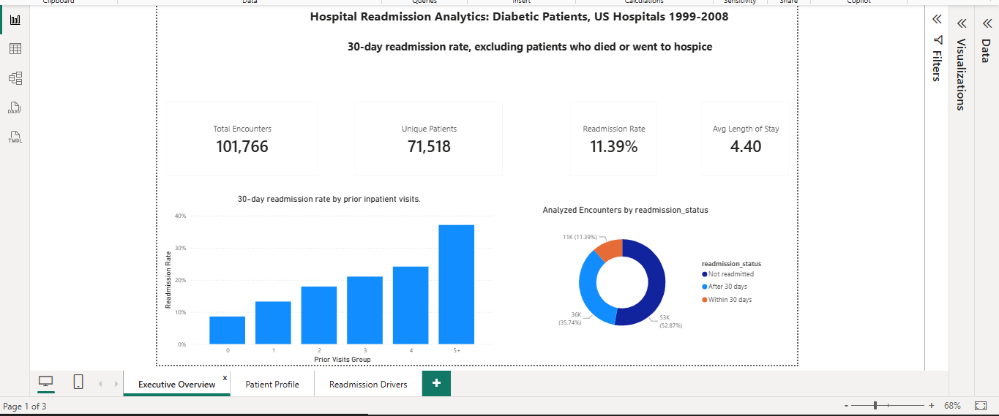
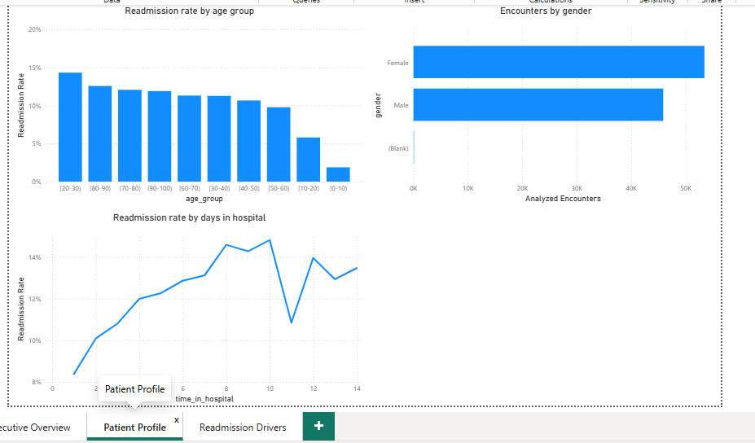
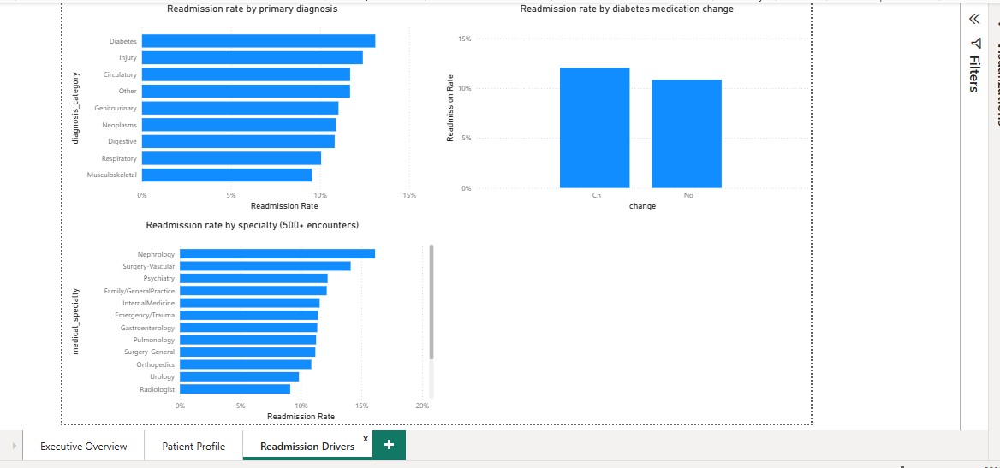

# Hospital Readmission Analytics

An end-to-end data analysis project on 101,766 real hospital encounters of diabetic patients. A raw, dirty CSV is loaded into PostgreSQL, cleaned with reproducible SQL, analysed with SQL queries, and presented in a three-page Power BI dashboard.

**Headline finding:** 11.39% of analysed encounters ended in a readmission within 30 days, and the rate climbs from 8.6% for patients with no prior inpatient visits to 37.1% for patients with five or more.

## Dashboard

### Executive Overview


### Patient Profile


### Readmission Drivers


The Power BI file is included: [`powerbi/healthcare_readmission.pbix`](powerbi/healthcare_readmission.pbix).

## The Problem

When a patient returns to hospital shortly after discharge, it often means something went wrong: discharge came too early, follow-up care was missing, or the condition was not well managed. Readmissions are costly and often preventable, so hospitals and insurers track them closely.

This project asks who gets readmitted within 30 days, and what goes with it.

## Dataset

**Diabetes 130-US Hospitals for Years 1999-2008**, from the [UCI Machine Learning Repository](https://archive.ics.uci.edu/dataset/296/diabetes-130-us-hospitals-for-years-1999-2008) (CC BY 4.0).

- 101,766 hospital encounters, 50 columns, plus a mapping file that decodes the ID columns
- Naturally dirty: missing values stored as `?`, a column that is about 97% empty, age ranges stored as text, numeric ID codes, and repeat patients

## Pipeline

```
Raw CSV  →  PostgreSQL staging (all TEXT)  →  SQL cleaning  →  Clean table + lookups + view  →  Power BI
```

**Why this approach:** the raw data is loaded untouched as text, so the import never fails on a bad value. Every cleaning decision is then written as SQL, so it is visible, reviewable and repeatable. Rows are flagged rather than deleted, so nothing is lost and every decision can be reversed.

## Data Cleaning

| Problem found | Count | Decision |
|---|---|---|
| `weight` missing | 98,569 (96.9%) | Dropped from the clean table |
| `medical_specialty` missing | 49,949 (49.1%) | `?` converted to NULL, kept |
| `payer_code` missing | 40,256 (39.6%) | `?` converted to NULL, kept |
| `race` missing | 2,273 (2.2%) | `?` converted to NULL, kept |
| `diag_1` / `diag_2` / `diag_3` missing | 21 / 358 / 1,423 | `?` converted to NULL |
| Gender `Unknown/Invalid` | 3 | Converted to NULL |
| Repeat patients | 30,248 repeat encounters, 71,518 unique patients | All kept, with a first-encounter flag |
| Duplicate encounter IDs | 0 | Nothing to remove |
| Patients who died or went to hospice | 2,423 | Flagged and excluded from readmission analysis |
| Glucose and HbA1c "None" | 94.7% / 83.3% | Kept as "not tested", since it is a real category |

Other steps: text columns cast to proper types, age ranges converted to a numeric midpoint, ID codes decoded through three lookup tables, and primary diagnosis codes grouped into categories.

Patients who died or went to hospice cannot meaningfully be readmitted, so they are excluded from rate calculations. This leaves **99,343** analysed encounters. Hospice patients are discharged alive, so excluding them is an analytic choice.

## Key Findings

The 30-day readmission rate is **11.39%** overall (11,314 of 99,343 analysed encounters).

- **Prior inpatient visits are the strongest pattern.** The rate rises at every step: 8.59% (0 prior visits), 13.25%, 17.93%, 21.03%, 24.14%, and 37.13% for 5 or more.
- **Length of stay:** the rate rises from 8.39% after a 1-day stay to about 14.6-14.8% at 8 to 10 days, then levels off.
- **Age:** the lowest rate is in the 50-60 group (9.77%), rising to 12.57% at 80-90. The 20-30 group is a surprise at 14.31% (1,649 encounters). The 0-10 and 10-20 groups are small, so their rates are unreliable.
- **Primary diagnosis:** diabetes as the primary diagnosis has the highest rate (13.10%), followed by injury (12.40%) and circulatory (11.69%). Respiratory is among the lowest (10.06%).
- **Specialty:** Nephrology is highest (16.11%) and Cardiology low (8.03%). Specialty is recorded for only about half of encounters, and the ranking covers specialties with 500+ encounters.
- **Medication change:** encounters with a medication change had a 12.02% rate, against 10.84% without.
- **HbA1c testing:** tested encounters had rates of about 9.8-10.2%, against 11.68% for those not tested. Only 17% of encounters have a test result.

**Important:** these are associations, not causes. Sicker patients probably stay longer, have more past admissions and have their medication changed more often, so the data cannot show that any of these factors causes readmission.

## Repository Structure

```
healthcare-readmission-analytics/
├── data/raw/       original CSV files from UCI
├── sql/            numbered SQL scripts: staging, profiling, cleaning, lookups and view, analysis queries
├── powerbi/        dashboard file and page screenshots
├── docs/           full project documentation
└── README.md
```

## How to Reproduce

1. Create a PostgreSQL database and run the staging script to create `stg_diabetes` with all columns as `TEXT`.
2. Load `diabetic_data.csv` into it with `\copy` (`FORMAT csv, HEADER true`).
3. Run the profiling and cleaning scripts to build `clean_encounters`.
4. Split `IDS_mapping.csv` into its three lookup tables, load them, and run the script that builds `vw_encounters_analysis`.
5. Run the analysis queries, or open the `.pbix` in Power BI Desktop and point it at `vw_encounters_analysis`.

## Limitations

- US hospitals, 1999-2008, diabetic patients only. Findings should not be generalised to other populations or conditions.
- The dataset has no admission dates, so "first encounter" means the lowest encounter ID, which is only a proxy for order.
- Specialty and payer information is missing for large shares of the data.
- The data is de-identified, and no attempt is made to identify individuals.

## Tools

PostgreSQL · SQL (DBeaver) · Power BI (DAX measures) · Git

## Author

**Robert Owuor Agie**, Computer Science (Data Analytics), University of Eldoret, Kenya
GitHub: [Robert837-sys](https://github.com/Robert837-sys) · LinkedIn: [robert-agie-26828a294](https://www.linkedin.com/in/robert-agie-26828a294)

*Dataset: Diabetes 130-US Hospitals for Years 1999-2008, UCI Machine Learning Repository.*
